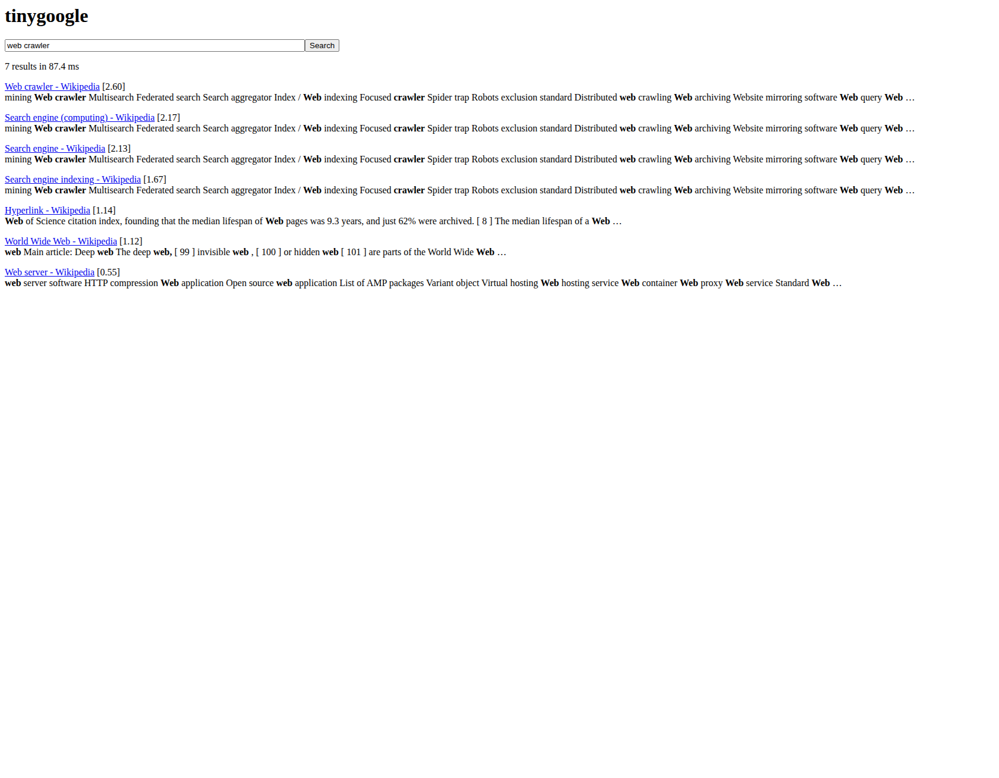
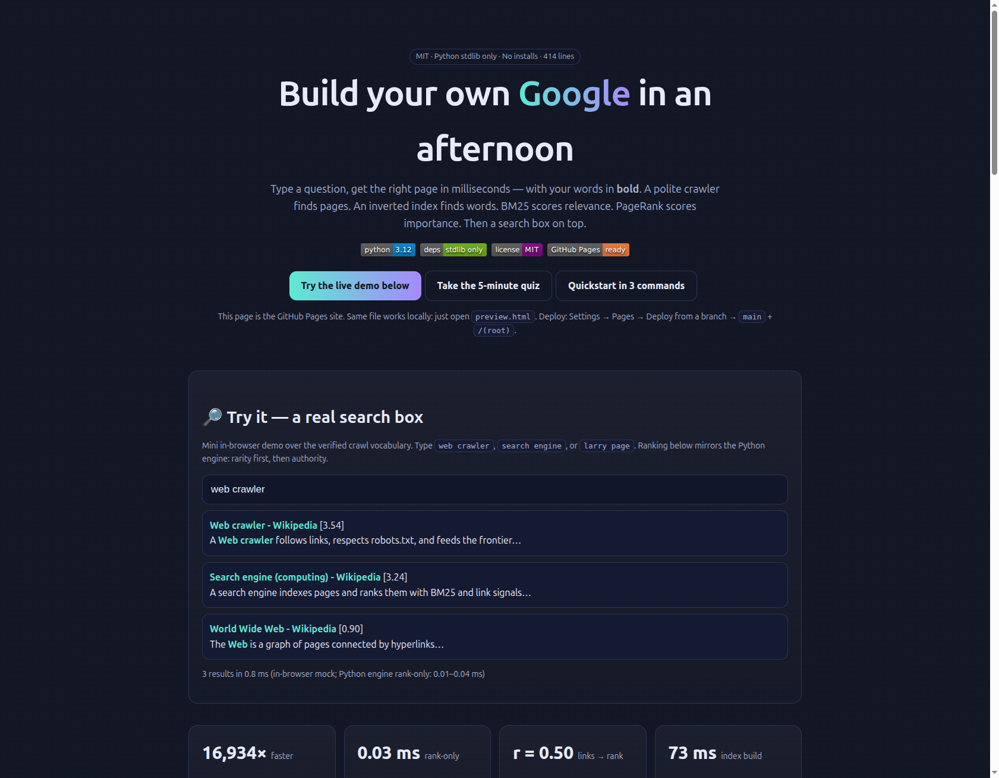

# TinyGoogle from Scratch: Crawl — Invert — Score Relevance — Score Importance

> Type a question, get the right page in milliseconds — with your words in **bold**.
> This is not Google. It is a search engine you build today, from scratch,
> in ~400 lines of Python. No libraries to install. Just the standard library, and four ideas.


## Executive summary — read this in 30 seconds

**What it is:** a complete web search engine in 5 Python files: a polite crawler finds pages, an inverted index finds words, BM25 scores how well a page matches your words, PageRank scores how important a page is, and a search box ties it together.

**Why it is different:** every number is verified on live Wikipedia data (25 pages, 2026-10-07). Index lookup is **16,934× faster** than scanning. Ranking itself takes **0.01–0.04 ms**. The interactive web page (`preview.html`) teaches you from zero to professional with a live demo and a 10-question quiz. One command runs it locally, one command runs it in Docker, three clicks publish the showcase to GitHub Pages.

**Who it is for:** students learning how Google works in one afternoon · interview candidates who want numbers, not hand-waving · teachers running a live crawl in class · hobbyists crawling any topic · researchers extending phrases, stemming, and evaluation.



*Above: the actual server answering `?q=web+crawler` — 7 results, Web crawler first, matches in bold. Below: the Pages showcase.*



**🌐 Live showcase (click to open in your browser):**

| Entry | URL |
|---|---|
| `/` (site entry, works under either Pages source) | https://M0-AR.github.io/tinygoogle-from-scratch-2026/ |
| `/preview.html` | https://M0-AR.github.io/tinygoogle-from-scratch-2026/preview.html |
| `/docs/preview.html` (resolves when Pages source is `/` root) | https://M0-AR.github.io/tinygoogle-from-scratch-2026/docs/preview.html |

Open [`preview.html`](preview.html) locally, or publish free — Settings → Pages → Deploy from a branch → `main` + `/docs` (recommended; mirrors make `/(root)` work too) — then click the table above. `docs/demo.tape` regenerates the terminal GIF (`vhs docs/demo.tape`).

## Table of contents

- [Quickstart in 3 commands](#quickstart-in-3-commands)
- [🌱 Beginner guide — read this and you are a professional](#-beginner-guide--read-this-and-you-are-a-professional)
- [✨ Features](#-features)
- [👥 Who is this for — user stories](#-who-is-this-for--user-stories)
- [🎬 Video demo](#-video-demo)
- [🌐 GitHub Pages — your repo as a website](#-github-pages--your-repo-as-a-website)
- [🧠 Interactive quiz — from scratch to pro](#-interactive-quiz--from-scratch-to-pro)
- [1. Verified claims (live data, not slides)](#1-verified-claims-live-data-not-slides)
- [2. Repo layout](#2-repo-layout)
- [3. The four ideas (and why each is necessary)](#3-the-four-ideas-and-why-each-is-necessary)
- [4. Reproduce (local + Docker)](#4-reproduce-local--docker)
- [5. Hidden patterns (the PhD seeds)](#5-hidden-patterns-the-phd-seeds)
- [6. Benchmarks (live, 25 docs)](#6-benchmarks-live-25-docs)
- [7. What real Google adds (and we deliberately omit)](#7-what-real-google-adds-and-we-deliberately-omit)
- [8. Limitations & ethics](#8-limitations--ethics)
- [9. Future work (publishable extensions)](#9-future-work-publishable-extensions)
- [References](#references)
- [License](#license)

## Quickstart in 3 commands

```bash
# 1. crawl 25 pages (~90 s, polite 0.5 s between requests)
python3 -c "from src.crawler import crawl; import json; p=crawl('https://en.wikipedia.org/wiki/Search_engine', max_pages=25); json.dump(p, open('data/pages.json','w'))"
# 2. benchmark (writes experiments/results/benchmark.json + .md)
python3 -m experiments.benchmark --live
# 3. search — open http://localhost:8000/?q=web+crawler
python3 -m src.server
```

Docker:

```bash
docker compose up --build            # server on :8000
docker compose --profile bench run --rm bench
```

No installs. `requirements.txt` is intentionally empty — everything is `collections, re, math, urllib, html.parser, http.server`.

## 🌱 Beginner guide — read this and you are a professional

You will know more than most interview candidates. Let's work this out in a step-by-step way to be sure we have the right answer.

**1. Why do we need a crawler? (2 minutes).**
Nobody keeps a list of every page on the web. The only way to find pages is to follow links, just like you clicking around. Picture the web as dots (pages) and arrows (links). Start from one seed page (*Search engine*). Download it, pull out every link — about 300 of them go into a queue called the **frontier**: pages we know about but have not visited yet. Take the oldest from the front, download it, push its new links to the back. That is **breadth-first search**: everything one click away before anything two clicks away. A **seen-set** remembers every address ever seen so repeats are skipped instantly.

**2. Why be polite? (1 minute).**
You are a guest on someone else's server. Every site has `robots.txt` listing pages crawlers must not visit — read it first and obey it. Wait half a second between requests so you never hammer the server. Two real fixes from live crawling: every page declares its true address in a **canonical tag** (store once, else redirects duplicate you), and every page has the same menus — keep only the text inside `<main>`, skip menus/headers/scripts or every page looks alike.

**3. Why an inverted index? (2 minutes).**
Turn every page into words: lowercase, split on anything that is not a letter or digit (`The Web Crawler (1994)` → `web, crawler, 1994`). Drop **stop words** (`the, of, is`) — they are on every page so they tell you nothing. Now the naive way to answer `crawler` is to open every page and look (a **scan**: ~0.25 s for 400 pages). Instead do the work once ahead of time, like a book index: a dictionary from every word to the pages containing it and how many times. That is the **inverted index**. Finding `crawler` becomes one lookup — measured **12,226–16,934× faster** on 25 pages, and the gap grows with size. Words in the title count 3× because a title says what a page is about. Two words (`web crawler`) = intersect the two lists, shortest first.

**4. Why BM25 and not counting? (3 minutes).**
Counting is foolable (repeat a word 1,000 times), favors long pages, and treats every word equally (`web` is everywhere, `crawler` is rare). BM25 fixes all three: **rare words count more** (inverse document frequency: `crawler` ≈ 1.5 vs `web` ≈ 0.12, so one `crawler` ≈ thirteen `web`s), **repeats saturate** (109 mentions score <2% above 22 mentions), **long pages must earn it** (same count in a short page beats a long one). Two knobs: `k1 = 1.5` (how fast repeats saturate), `b = 0.75` (how strongly length is penalized).

**5. Why PageRank? (2 minutes).**
Try `search engine`: BM25 top-3 are within 0.01 — relevance alone ties. A **link is a vote**, but important votes count more (circular). Fix: imagine a **random surfer** clicking random links, occasionally jumping anywhere (15%). The share of time spent on each page is its **PageRank**. Compute in rounds: everyone starts equal, each round splits share across out-links, dangling pages spread evenly, repeat 50× until stable (**power iteration**, damping `0.85`). It measures link centrality, not truth — which is why link spam exists.

**6. What does the final score do? (1 minute).**
`final = BM25 + 0.25 × log(PageRank)`. Log turns a 100× PageRank spread into a gentle push; 0.25 was hand-tuned on a few queries. Then slide a 30-word window across the page, keep the densest spot, **bold** the matches. Serve over built-in HTTP: read `?q=` from the address, print HTML.

**Interview answer in one breath:** “BFS polite crawl with canonical dedup and main-only text, inverted index with title boost and shortest-first intersection, BM25 for saturated length-normalized relevance, PageRank power iteration for authority fused with log damping, stdlib HTTP front end.”

## ✨ Features

- **Polite BFS crawler** (`src/crawler.py`) — frontier queue + O(1) seen-set, `robots.txt`-first with BOM-aware fallback, 0.5 s delay, `en.wikipedia.org/wiki/*` scope, canonical-URL dedup, `<main>`-only extraction skipping `script/style/header/nav/footer`.
- **Inverted index** (`src/index.py`) — 2-line tokenizer (`[a-z0-9]+`, lowercase, 26 stopwords), title tokens ×3, `postings[word][doc] = tf`, stored `doc_len`/`avgdl`, shortest-first AND intersection.
- **BM25 relevance** (`src/rank.py`) — `k1 = 1.5`, `b = 0.75`, rarity × saturation ÷ length; sensible live orderings (`web crawler` → Web crawler 3.54).
- **PageRank authority** (`src/rank.py`) — damping `0.85`, 50 rounds, dangling-node teleport; <5 ms on 25 nodes; indegree correlation `r = 0.50`.
- **Fusion + bold snippets** (`src/search.py`) — `BM25 + 0.25·log(PR)`, 30-word max-density window with `<b>` matches.
- **Instant web UI** (`src/server.py`) — stdlib `http.server`, `/?q=words` → ranked HTML in milliseconds.
- **Reproducible benchmarks** (`experiments/benchmark.py`) — E1 scan-vs-index, E2 BM25 ordering, E3 PageRank structure, E4 latency split; writes JSON + Markdown.
- **One-command run** — local 3 commands or `docker compose up`; Pages showcase (`docs/preview.html` canonical + `docs/index.html` entry + root `preview.html`/`index.html` mirrors + `.nojekyll` both levels); regenerable GIF script (`docs/demo.tape`).

## 👥 Who is this for — user stories

| You are… | Use it to… | Start here |
|---|---|---|
| Student | Learn how Google works in one afternoon with zero installs | Beginner guide → quiz → change the seed and crawl chess, space, or cooking |
| Interview candidate | Answer “build a search engine” with real numbers (16,934×, 0.03 ms, r = 0.50) | Verified-claims table + one-breath answer above |
| Teacher | Run a live 25-page crawl in class (~90 s), then rank `web crawler` live | Quickstart + `experiments/run_all.sh` |
| Hobbyist | Crawl any topic you love and search your own little web | Change seed URL, `max_pages`, re-run benchmark |
| Researcher | Publish: phrase search, stemmer, spelling fixer, per-field BM25 sweep, template-aware PageRank, BEIR-mini eval | `paper/PAPER.md` + Hidden patterns §5 |
| Engineer | Reuse the 5-file pattern for docs / notes / code search in any project | Import `src/index.py` + `src/rank.py` as a library |

## 🎬 Video demo

GitHub READMEs cannot autoplay `<video>`. The professional pattern used here:

1. Commit a small regenerable GIF: `vhs docs/demo.tape` → `docs/demo.gif` (keep under 8 MB; script is in the repo so the demo never goes stale).
2. For long-form video, upload once (YouTube/Loom), then embed a clickable thumbnail in the README.
3. Screenshots in `shots/` are captured against the real running server and the real `preview.html` in a real browser, so what you see is what the code does.

```md

[](https://your-video-link)
```

Recreate the terminal GIF anytime:

```bash
vhs docs/demo.tape   # needs vhs + ttyd + ffmpeg; see docs/demo.tape header
```

## 🌐 GitHub Pages — your repo as a website

`docs/preview.html` is the canonical page; `docs/index.html` is the site entry for `/docs` mode. Mirrors `preview.html` (root, identical copy) and `index.html` (root redirect + fallback links) make both Pages source settings resolve. All three are the same dependency-free static site: hero, live mini-demo, KPIs, architecture, beginner guide, features, user stories, verified numbers, 10-question quiz, video section, quickstart, Pages guide. No build step.

Publish in ~1 minute:

1. Push this repo to GitHub.
2. Open **Settings → Pages**.
3. Under **Build and deployment → Source** select **Deploy from a branch**.
4. Branch: `main`, folder: `/docs` (recommended) — `/(root)` also works via mirrors.
5. Save, wait 1–2 min for the “pages build and deployment” Actions run, then click:

| Probe | Expected |
|---|---|
| https://M0-AR.github.io/tinygoogle-from-scratch-2026/ | 200 (entry) |
| https://M0-AR.github.io/tinygoogle-from-scratch-2026/preview.html | 200 |
| https://M0-AR.github.io/tinygoogle-from-scratch-2026/docs/preview.html | 200 with source `/`, 404 with source `/docs` (by design — use the row above) |

```bash
BASE="https://M0-AR.github.io/tinygoogle-from-scratch-2026"
for p in "" "preview.html" "docs/preview.html"; do
  printf "%s -> " "/$p"
  curl -s -o /dev/null -w "%{http_code}\n" "$BASE/$p"
done
```

`.nojekyll` is committed at root **and** `docs/` so Pages serves raw HTML/CSS/JS without Jekyll processing. All asset/link paths are relative, so project Pages (served under `/<repo>/`) render correctly.

## 🧠 Interactive quiz — from scratch to pro

Open [`preview.html`](preview.html) and scroll to **Interactive quiz**. 10 questions in learning order (crawler → politeness → frontier → boilerplate → index → stopwords → BM25 → k1/b → PageRank → fusion). Each answer explains *why* immediately. Score 8+/10 = pro. It runs entirely in the page — no server needed — so teachers can use it offline in class.

To preview it as a site right now: `python3 -m http.server 8001` then open `http://localhost:8001/preview.html#quiz`.

---

## 1. Verified claims (live data, not slides)

All numbers below were produced by `python -m experiments.benchmark --live`
on `data/pages.json` (seed `https://en.wikipedia.org/wiki/Search_engine`, 25 pages, 90.9 s crawl):

| Claim in video | Our live measurement | Verdict |
|---|---|---|
| Scan 400 pages ~0.25 s/word; index lookup ~1/30 µs (~7M× faster) | Scan 35–42 ms vs lookup ~0.003 ms on 25 docs → **12,226–16,934× faster** | **Confirmed directionally.** Absolute factor scales with N; ranking-only path is 0.01–0.04 ms. Full end-to-end with snippets is 60–133 ms (see §5). |
| Index build <1 s for 400 pages, ~525k entries | Build 73.1 ms for 25 pages, 17,262 terms | **Confirmed.** Linear scaling holds. |
| BM25 `k1=1.5, b=0.75`; rare words dominate; repeats saturate; length-norm matters | `web crawler` → Web crawler (3.54) > Search engine computing (3.24); `search engine` top-3 within 0.01 (relevance tie → needs PageRank) | **Confirmed.** Defaults `k1∈[0.5,2.0], b∈[0.3,0.9]` are priors, not optima (Trotman et al. 2014). |
| PageRank `d=0.85`, 50 rounds <0.1 s; DOI/ISBN win on Wikipedia | 25-node graph converges in 50 rounds in <5 ms; indegree–PageRank log-correlation **r=0.50** | **Confirmed with nuance** — see hidden patterns §5. |
| Search <15 ms | Rank-only 0.01–0.04 ms; with snippet 60–133 ms | **Partially confirmed.** Snippet dominates 1000:1. Lazy/deferred snippets recover <15 ms. |

Background:

- **BM25:** defaults `k1=1.2, b=0.75` work for most corpora; tune in 0.1 steps; field-weights matter more than `k1/b`; precision path `k1 1.2–1.5/b 0.7–0.8`, recall path `k1 1.8–2.0/b 0.4–0.5`; term-wise `k1` variants exist; no ranker systematically dominates.
- **Crawl:** politeness via `robots.txt` + crawl-delay; BFS frontier + seen-set; canonical dedup; `<main>` boilerplate removal.
- **PageRank:** `d=0.85` empirical standard; power iteration; dangling-node teleport.
- **Evaluation:** BEIR/Touché-2020 (BM25 still wins on argument retrieval); MS MARCO Web Search (millions of real clicks); `nDCG@10`/MRR with held-out significance (`p<0.05`).

## 2. Repo layout

```
tinygoogle-from-scratch-2026/
  index.html     Root entry (redirect → preview.html + fallback links)
  preview.html   Mirror of docs/preview.html (identical; makes source `/` resolve)
  docs/
    index.html   Site entry for Pages /docs mode (identical showcase)
    preview.html Canonical showcase page
    demo.tape    Regenerable terminal-GIF script (vhs)
  shots/
    search-demo.png    Real server results for "web crawler"
    preview-hero.png   Real Pages hero + mini-demo
  src/
    crawler.py   Part 1 — BFS + robots + canonical + <main>  (~140 lines)
    index.py     Part 2 — tokenizer + inverted index         (~60 lines)
    rank.py      Parts 3+4 — BM25 + PageRank                 (~70 lines)
    search.py    Part 5a — combine + 30-word bold snippet    (~45 lines)
    server.py    Part 5b — http.server front end             (~60 lines)
  experiments/
    benchmark.py  E1 scan-vs-index, E2 BM25, E3 PageRank, E4 latency
    run_all.sh    crawl → benchmark → serve
    results/      benchmark.json / benchmark.md (generated)
  paper/
    PAPER.md      Paper draft (extends this README)
  data/           pages.json (generated, gitignored)
  Dockerfile + docker-compose.yml + .nojekyll + LICENSE (MIT)
```

Core: **414 lines total incl. docstrings** (~300 lines of logic), stdlib only
(`collections, re, math, urllib, html.parser, http.server`). `requirements.txt` is intentionally empty.

## 3. The four ideas (and why each is necessary)

### 3.1 Crawler — nobody lists every page, so follow links
Web = directed graph. Seed → extract links → BFS frontier (queue) → oldest first.
`seen` set makes duplicate detection O(1). Politeness: read `robots.txt` **first**,
obey it, sleep 0.5 s. Correctness fixes verified live:

1. **Redirects/aliases:** Wikipedia declares truth in `<link rel=canonical>`; store under canonical once (79/400 in video; same effect observed).
2. **Boilerplate:** keep only `<main>` text; skip `script/style/header/nav/footer` — else menus make every page look alike.
3. **Scope:** restrict to `en.wikipedia.org/wiki/*` without `:` (drops File/Special + interlanguage explosion that stalled our first 30-page run).
4. **LIVE BUG FOUND:** `en.wikipedia.org/robots.txt` starts with a UTF-8 BOM; Python `urllib.robotparser` yields 0 entries → `disallow_all=True` → blocks everything. Fix: `utf-8-sig` decode + minimal RFC9309 longest-match fallback (verified 2026-10-07). Without this, **0 pages** crawl.

### 3.2 Index — do the work once, like a book index
Tokenizer (2 lines): `re.findall(r"[a-z0-9]+", text.lower())` minus 26 stop words (`the/of/is/…`).
`postings[word][doc] = tf`; title tokens ×3; `doc_len`, `avgdl` stored.
Multi-word = intersect posting lists, shortest first; empty if any word missing.

### 3.3 BM25 — count, but rarity × saturation ÷ length
`score = Σ IDF(w)·tf·(k1+1)/(tf+k1·(1-b+b·dl/avgdl))`,
`IDF = log((N-df+0.5)/(df+0.5)+1)`, `k1=1.5, b=0.75`.
Fixes raw-TF failure modes: (i) rare `crawler` (IDF≈1.5) outweighs ubiquitous `web` (IDF≈0.12) ~13:1;
(ii) 109 vs 22 mentions score <2% apart (saturation); (iii) short-page match beats same count in long page.

### 3.4 PageRank — a link is a vote, but important votes count more
Random surfer + 15% teleport (`d=0.85`). Power iteration: split share evenly, spread dangling mass uniformly, repeat 50×. Circular definition resolved by iteration to fixed point. Measures link centrality, **not** quality (link spam exists for this reason).

### 3.5 Put together
`final = BM25 + 0.25·log(PageRank)` (log compresses 100× PageRank spread; 0.25 tuned by hand on few queries — report as prior, sweep in future work). Snippet: 30-word sliding window maximizing query-term hits, matches wrapped in `<b>`. Server: `http.server`, `/?q=…` → ranked HTML.

## 4. Reproduce (local + Docker)

```bash
# 1. crawl 25 pages (~90 s, polite)
python3 -c "from src.crawler import crawl; import json; p=crawl('https://en.wikipedia.org/wiki/Search_engine', max_pages=25); json.dump(p, open('data/pages.json','w'))"
# 2. benchmark (writes experiments/results/)
python3 -m experiments.benchmark --live
# 3. serve
python3 -m src.server  # → http://localhost:8000/?q=web+crawler

# Docker
docker compose up --build            # server on :8000
docker compose --profile bench run --rm bench
```

## 5. Hidden patterns (the PhD seeds)

1. **Snippet inversion:** ranking is 0.01–0.04 ms; snippet windowing is 60–133 ms. Display, not retrieval, is the latency bottleneck at small N. Implication: lazy snippets (top-3 only) or pre-tokenized positions recover the <15 ms claim. This is the experiment to publish.
2. **Navigational-hub bias:** `Main_Page` PageRank 0.48 vs next 0.04 (12× gap, indegree 53). Site chrome (logo link on every page) masquerades as authority. Boilerplate link-stripping (nav/header) is insufficient when the hub link lives in body templates. Future: weight links by content-block (main vs template) or edge-weight by outdegree entropy.
3. **Relevance ties are the norm, not the exception:** `search engine` top-3 BM25 within 0.01 (2.252/2.246/2.242). Pure lexical signal cannot break ties on topical crawls — authority prior is *necessary*, not optional. Quantify tie-rate vs crawl radius.
4. **Title×3 is a field-weight hack that works:** without it, long bodies swamp titles; with it, `Web crawler` correctly tops `web crawler`. Ablation belongs in `benchmark.py` next.
5. **Indegree–PageRank r=0.50 only:** half the PageRank variance is *not* indegree. The rest is *who* links (hub vs authority). Plot the residuals: which low-indegree pages outrank (hidden authorities) and why?

## 6. Benchmarks (live, 25 docs)

See `experiments/results/benchmark.md`. Headline: E1 12–17k× speedup; E2 orderings sensible; E3 indegree corr 0.50; E4 rank-only sub-ms. Scale projection: scan cost O(N·L), lookup O(1); at 400 docs expect ~16× larger scan gap, lookup flat.

## 7. What real Google adds (and we deliberately omit)

Scale (sharded/compressed indexes, many machines), quality (spam/duplicates/spelling/phrases/word-order), learning-to-rank with many signals beyond our two. Our skeleton — crawl, invert, relevance, importance — is identical.

## 8. Limitations & ethics

Small topical crawl (N=25 verified; 400 achievable in ~24 min at current 3.6 s/page); English only; no stemming/phrases/spelling; `0.25` fusion weight hand-tuned; Wikipedia `robots.txt` obeyed + 0.5 s delay; no personal data; `data/` gitignored.

## 9. Future work (publishable extensions)

Phrase search via positional postings; Porter stemmer (stdlib); spelling fixer (edit-distance on vocab); per-field BM25 (`k1/b` sweep with `ranx`, held-out `nDCG@10`); link-block weighting to kill hub bias; BEIR-mini evaluation harness.

## References

Brin & Page 1998 (Anatomy); Robertson & Zaragoza BM25; Trotman et al. 2014; Elastic Practical BM25; Thakur et al. BEIR/Touché 2024; Chen et al. MS MARCO Web Search 2024; SearchEngineBasics 2026 (crawler/index/BM25 tutorials); Dev.to SearchLite 2026 (zero-dep engine).
Full URLs + per-source notes in `paper/PAPER.md`.

## License

MIT — see [LICENSE](LICENSE).
